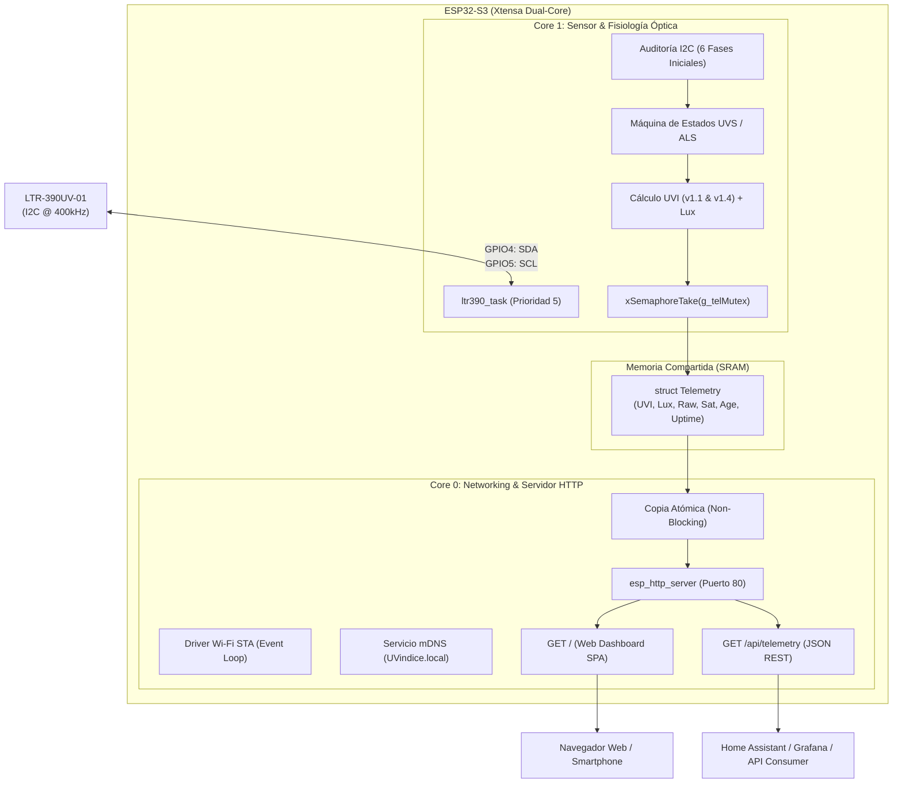

# ☀️ ESP32-S3 LTR-390UV-01 | Dual-Core UV Index & Lux Meteorological Station

<div align="center">


<p align="center">
  <b>Estación meteorológica de radiación solar y luminancia ambiental con arquitectura asíncrona dual-core, autocalibración óptica multi-revisión, servidor HTTP nativo y panel web en tiempo real.</b>
</p>

[Arquitectura](#-arquitectura-del-sistema) •
[Características](#-características-principales) •
[Física y Formulaciones](#-física-y-modelado-matemático) •
[Fases de Diagnóstico](#-pipeline-de-auditoría-del-sensor) •
[Conexión y Pinout](#-conexión-de-hardware) •
[API REST](#-especificación-de-la-api-rest) •
[Puesta en Marcha](#-guía-de-compilación-y-despliegue)

---

</div>

## 📌 Descripción General

Este proyecto implementa una solución de instrumentación meteorológica embebida basada en el microcontrolador **ESP32-S3** (Xtensa® 32-bit LX7 dual-core a 240 MHz) y el sensor radiométrico digital **Lite-On LTR-390UV-01** comunicado a través de un bus I2C maestro a 400 kHz.

El firmware está desarrollado sobre el framework nativo **ESP-IDF v5.x** bajo PlatformIO, aprovechando una partición asimétrica de núcleos FreeRTOS:
1. **Core 1 (Muestreo y Física):** Ejecuta una máquina de estados de adquisición no bloqueante, caracterización espectral, detección de saturación y cálculo continuo de índice de radiación ultravioleta (**UVI**) e iluminancia ambiental (**Lux**).
2. **Core 0 (Conectividad y Red):** Gestiona la pila de red TCP/IP (lwIP), reconexión Wi-Fi STA en segundo plano, resolución de nombres mDNS (`http://UVindice.local`) y un servidor web empotrado (`esp_http_server`) que sirve una Single Page Application (SPA) y una API RESTful en JSON.

---

## ⚡ Características Principales

- **Concurrencia Estricta Dual-Core:** Tarea de sensor desacoplada en el Core 1 y pila Wi-Fi/HTTP confinada al Core 0, comunicadas de forma segura mediante `SemaphoreHandle_t` (FreeRTOS Mutex).
- **Driver I2C Moderno (`driver/i2c_master.h`):** Diseñado con la nueva API unificada de ESP-IDF v5 sin bloqueos de bus y con timeouts acotados.
- **Autocalibración Óptica Multi-Datasheet:** Calcula el índice UVI según las dos revisiones oficiales de Lite-On (Rev V1.1: $2300 \text{ cuentas/UVI}$ y Rev V1.4: $1400 \text{ cuentas/UVI}$ @ 18x gain, 20-bit).
- **Protección de Saturación de Canal:** Identifica saturación foto-diodal UVS/ALS en tiempo de ejecución para evitar lecturas espurias.
- **Panel Web Reactivo (SPA):** Tablero responsive HTML5/CSS3/JS empotrado en la memoria Flash del SoC, sin dependencias externas, con indicación de nivel de riesgo OMS (Bajo, Moderado, Alto, Muy Alto, Extremo).
- **Servicio mDNS:** Descubrimiento de red automático en la URL amigable `http://UVindice.local`.
- **API RESTful JSON:** Endpoint `/api/telemetry` con soporte CORS para integración con Grafana, Home Assistant o microservicios IoT.
- **Fácil Configuración:** Parámetros de red Wi-Fi y mDNS directamente accesibles y editables al inicio de `src/main.cpp`.

---

## 🧠 Arquitectura del Sistema



---

## 📐 Física y Modelado Matemático

### 1. Cálculo del Índice Ultravioleta (UVI)

El LTR-390UV-01 mide la irradiancia en el espectro UV solar (pico de sensibilidad en $\approx 280\text{–}320\text{ nm}$). La sensibilidad normalizada depende de la ganancia fotodiodal ($\text{Gain}$) y del tiempo de integración ($\text{IntegMs}$):

$$\text{Sensibilidad} = \text{Sens}_{\text{ref}} \times \left(\frac{\text{Gain}}{18.0}\right) \times \left(\frac{\text{IntegMs}}{400.0}\right)$$

Donde el índice de radiación se calcula mediante:

$$\text{UVI} = \left(\frac{\text{Cuentas}_{\text{UVS}}}{\text{Sensibilidad}}\right) \times \text{WF}$$

* $\text{WF}$: Factor de ventana óptica (1.0 al aire libre).
* $\text{Sens}_{\text{ref}}$ (Rev V1.1): $2300 \text{ cuentas/UVI}$ (@ Gain 18x, 20-bit / 400 ms).
* $\text{Sens}_{\text{ref}}$ (Rev V1.4): $1400 \text{ cuentas/UVI}$ (@ Gain 18x, 20-bit / 400 ms).

### 2. Cálculo de Iluminancia Ambiental (Lux)

Para la respuesta del ojo humano (fotópica CIE), el canal ALS opera bajo la formulación:

$$\text{Lux} = \left(\frac{0.6 \times \text{Cuentas}_{\text{ALS}}}{\text{Gain} \times \left(\frac{\text{IntegMs}}{100.0}\right)}\right) \times \text{WF}$$

### 3. Escala OMS / EPA de Riesgo UV

| Rango UVI | Nivel de Riesgo | Código Color | Recomendaciones OMS |
| :---: | :---: | :---: | :--- |
| **0.0 – 2.9** | **Bajo** | 🟢 `#10b981` | Exposición segura. No requiere protección especial. |
| **3.0 – 5.9** | **Moderado** | 🟡 `#f59e0b` | Aplicar protector FPS 30+, gorra y lentes en horas pico. |
| **6.0 – 7.9** | **Alto** | 🟠 `#f97316` | Buscar sombra entre 10:00 y 16:00. Ropa de manga larga. |
| **8.0 – 10.9** | **Muy Alto** | 🔴 `#ef4444` | Protección extra obligatoria. Evitar el sol en horas centrales. |
| **$\ge$ 11.0** | **Extremo** | 🟣 `#8b5cf6` | Radiación peligrosa. Riesgo de quemaduras en minutos. |

---

## 🔍 Pipeline de Auditoría del Sensor

Al energizarse, el sistema ejecuta 6 pruebas diagnósticas en el Core 1 antes de entrar al ciclo continuo:

```
[1] DETECCIÓN I2C: Escaneo y lectura del registro PART_ID (0x06 -> Esperado: 0xB2).
[2] DUMP REGISTROS: Volcado de registros 0x00 a 0x26 en estado post-reset.
[3] VALIDACIÓN DE RESET: Comprobación del bit SW_RESET (0x00 Bit 4) y auto-clearing.
[4] BARRIDO DE MATRIZ: Validación de 5 ganancias (1x a 18x) y 6 resoluciones (13 a 20 bits).
[5] RUIDO DE FONDO (BASELINE): 5 muestras consecutivas para desviación típica de offset.
[6] COMPARADOR DIGITAL: Disparo y clear-on-read del bit Interrupt_Status (0x07 Bit 4).
```

---

## 🔌 Conexión de Hardware

| Pin Sensor LTR-390UV | Pin ESP32-S3 DevKitC-1 | Función | Notas |
| :---: | :---: | :---: | :--- |
| **VCC** | **3V3** | Alimentación 3.3 V | Regulador interno o bus 3.3V del DevKit |
| **GND** | **GND** | Tierra común | Referencia 0 V |
| **SDA** | **GPIO 4** | I2C Serial Data | Frecuencia: 400 kHz (Fast Mode) |
| **SCL** | **GPIO 5** | I2C Serial Clock | Frecuencia: 400 kHz |
| **INT** | *No conectado* | Interrupción física | Diagnósticos evaluados por pooling de registro |

> [!NOTE]  
> Los pines GPIO6 y GPIO7 quedan completamente libres para periféricos adicionales (pantallas OLED, buses SPI o transceptores LoRa).

---

## 🌐 Especificación de la API REST

### `GET /api/telemetry`

Retorna el estado de radiación, mediciones fotométricas y estado operativo en formato JSON.

#### Ejemplo de Respuesta:

```json
{
  "uvi_v1_1": 4.12,
  "uvi_v1_4": 6.77,
  "uvs_raw": 9476,
  "uvs_sat": false,
  "lux": 1542.3,
  "als_raw": 7711,
  "als_sat": false,
  "risk_level": "MODERADO",
  "uptime_s": 1284,
  "valid": true,
  "sensor_ok": true,
  "data_age_s": 0,
  "data_age_ms": 142,
  "rssi": -58
}
```

#### Descripción de Campos:

- `uvi_v1_1` *(float)*: Índice UV derivado según la ecuación de la hoja de datos Rev V1.1.
- `uvi_v1_4` *(float)*: Índice UV derivado según la ecuación de la hoja de datos Rev V1.4.
- `uvs_raw` *(integer)*: Cuentas directas acumuladas por el convertidor ADC ultravioleta.
- `uvs_sat` *(boolean)*: `true` si el ADC alcanzó su techo de cuentas (saturación).
- `lux` *(float)*: Iluminancia ambiental calculada en Lux.
- `als_raw` *(integer)*: Cuentas directas acumuladas por el convertidor ADC de luz visible.
- `als_sat` *(boolean)*: Indicador de saturación en luz visible.
- `risk_level` *(string)*: Clasificación oficial OMS (`BAJO`, `MODERADO`, `ALTO`, `MUY ALTO`, `EXTREMO`).
- `uptime_s` *(integer)*: Segundos transcurridos desde el inicio del microcontrolador.
- `sensor_ok` *(boolean)*: `true` si el bus I2C responde normalmente a las transacciones.
- `data_age_ms` *(integer)*: Milisegundos transcurridos desde la última captura física.
- `rssi` *(integer)*: Intensidad de señal Wi-Fi recibida en dBm.

---

## 🚀 Guía de Compilación y Despliegue

### Requisitos Previos

- [PlatformIO Core](https://platformio.org/install/cli) o extensión **PlatformIO IDE** en Visual Studio Code.
- Placa de desarrollo **ESP32-S3-DevKitC-1** (o equivalente con ESP32-S3 con 8 MB Flash).
- Sensor **LTR-390UV-01** conectado a los pines I2C indicados.

### 1. Clonar el Repositorio

```bash
git clone https://github.com/JSerr5/esp32-s3-ltr390-uv-monitor.git
cd esp32-s3-ltr390-uv-monitor
```

### 2. Configurar Credenciales Wi-Fi

Abre el archivo `src/main.cpp` y edita directamente las líneas con el SSID y contraseña de tu red Wi-Fi (2.4 GHz):

```cpp
#define WIFI_SSID      "TuRedWiFi"
#define WIFI_PASS      "TuClaveSecreta"
```

### 3. Compilación y Carga de Firmware

Compilar el proyecto:

```bash
pio run
```

Cargar en el microcontrolador y abrir monitor serial:

```bash
pio run --target upload --target monitor
```

---

## 🖥️ Acceso a la Interfaz Web

Una vez conectado a tu red local Wi-Fi, abre tu navegador preferido:

- **Por nombre mDNS:** [http://UVindice.local](http://UVindice.local)
- **Por dirección IP:** La IP asignada se muestra en la consola serial durante el arranque (ej. `http://192.168.1.150`).

---

## 📄 Estructura del Proyecto

```
esp32-s3-ltr390-uv-monitor/
├── include/
│   └── README
├── lib/                      # Librerías auxiliares (opcional)
├── src/
│   ├── CMakeLists.txt        # Registro de componentes ESP-IDF
│   ├── idf_component.yml     # Dependencia gestionada de espressif/mdns
│   └── main.cpp              # Implementación principal dual-core + HTTP SPA
├── CMakeLists.txt            # CMake raíz del proyecto
├── dependencies.lock         # Bloqueo de versiones de componentes ESP-IDF
├── platformio.ini             # Configuración de entorno y flags PlatformIO
├── sdkconfig.defaults        # Parámetros de kernel ESP-IDF (Flash 8MB, tick 1ms, UART)
└── README.md                 # Documentación técnica completa
```

---

## 🛡️ Licencia

Distribuido bajo la Licencia **MIT**. Consulta el archivo `LICENSE` o la cabecera de los archivos fuente para más información.
